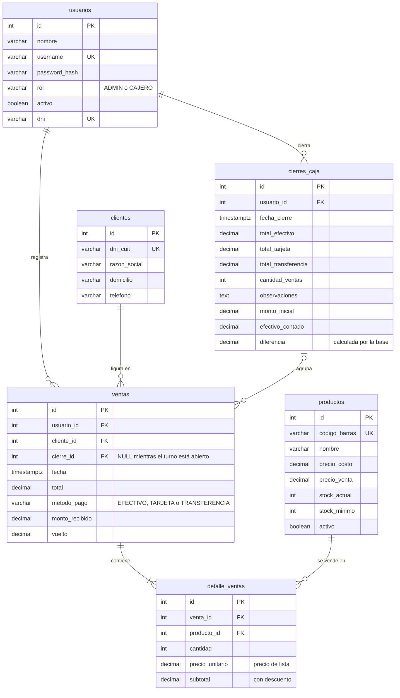

# Base de datos — Web Kiosko

- **Motor:** PostgreSQL 12 o superior (las columnas calculadas necesitan la versión 12).
- **Script:** [`database/init.sql`](../database/init.sql). Crea las tablas, las restricciones, los índices, la vista y el cliente "Consumidor Final". Se puede correr más de una vez: en una base vacía crea todo y en una que ya existía agrega solo lo que falta, sin borrar datos.
- **Modelos del backend:** [`backend/app/models/`](../backend/app/models/) (SQLAlchemy, un archivo por tabla).
- **Usuarios iniciales:** los crea [`backend/app/db/seed.py`](../backend/app/db/seed.py) (`admin` y `cajero`).

## Diagrama entidad-relación



Cómo leer las relaciones:

| Relación | Cardinalidad | Qué significa |
| --- | --- | --- |
| `usuarios` → `ventas` | 1 a muchos | Cada venta la registra un usuario (el cajero que cobró). |
| `usuarios` → `cierres_caja` | 1 a muchos | Cada cierre de turno queda a nombre del usuario responsable. |
| `clientes` → `ventas` | 1 a muchos | Toda venta tiene cliente; por defecto es "Consumidor Final" (id 1). |
| `cierres_caja` → `ventas` | 0 o 1 a muchos | Una venta pertenece a un cierre recién cuando se cierra el turno. |
| `ventas` → `detalle_ventas` | 1 a 1 o más | Una venta tiene al menos una línea (lo valida el backend). |
| `productos` → `detalle_ventas` | 1 a muchos | Cada línea de venta es de un producto. |

## Tablas

### `usuarios`

Personas que entran al sistema. No hay registro público: los crea el administrador.

| Columna | Tipo | Nulo | Por defecto | Descripción |
| --- | --- | --- | --- | --- |
| `id` | `SERIAL` | No | autonumérico | Clave primaria. |
| `nombre` | `VARCHAR(100)` | No | | Nombre para mostrar (aparece en tickets y reportes). |
| `username` | `VARCHAR(50)` | No | | Usuario de login. Único. |
| `password_hash` | `VARCHAR(255)` | No | | Contraseña hasheada con bcrypt. Nunca se guarda en texto plano. |
| `rol` | `VARCHAR(20)` | No | | `ADMIN` o `CAJERO` (CHECK). |
| `activo` | `BOOLEAN` | Sí | `TRUE` | Un usuario inactivo no puede iniciar sesión. Se usa en vez de borrar a quien ya tiene ventas. |
| `dni` | `VARCHAR(20)` | Sí | | DNI del empleado. Único. |

### `productos`

Catálogo del kiosco.

| Columna | Tipo | Nulo | Por defecto | Descripción |
| --- | --- | --- | --- | --- |
| `id` | `SERIAL` | No | autonumérico | Clave primaria. |
| `codigo_barras` | `VARCHAR(50)` | No | | Código que lee el escáner del POS. Único. |
| `nombre` | `VARCHAR(150)` | No | | Descripción del producto. |
| `precio_costo` | `DECIMAL(12,2)` | No | | Precio de compra. Solo lo ve el administrador. `>= 0`. |
| `precio_venta` | `DECIMAL(12,2)` | No | | Precio de lista. `>= 0`. |
| `stock_actual` | `INT` | No | `0` | Unidades disponibles. Baja con cada venta. `>= 0`. |
| `stock_minimo` | `INT` | No | `5` | Por debajo de este valor el producto entra en alerta de stock bajo. `>= 0`. |
| `activo` | `BOOLEAN` | No | `TRUE` | Baja lógica: un producto con ventas no se puede borrar, pero sí desactivar. |

### `clientes`

Clientes que piden ticket o factura a su nombre. El 90 % de las ventas van a "Consumidor Final".

| Columna | Tipo | Nulo | Por defecto | Descripción |
| --- | --- | --- | --- | --- |
| `id` | `SERIAL` | No | autonumérico | Clave primaria. El id 1 es siempre "Consumidor Final". |
| `dni_cuit` | `VARCHAR(20)` | No | | DNI o CUIT (11 dígitos = CUIT). Único. Consumidor Final usa `'0'`. |
| `razon_social` | `VARCHAR(150)` | No | | Nombre o razón social. |
| `domicilio` | `VARCHAR(200)` | Sí | | |
| `telefono` | `VARCHAR(50)` | Sí | | |

### `ventas`

Cabecera de cada venta del POS.

| Columna | Tipo | Nulo | Por defecto | Descripción |
| --- | --- | --- | --- | --- |
| `id` | `SERIAL` | No | autonumérico | Clave primaria. Es el número de ticket. |
| `usuario_id` | `INT` | No | | FK a `usuarios`. Cajero que cobró. |
| `cliente_id` | `INT` | No | | FK a `clientes`. `1` = Consumidor Final. |
| `cierre_id` | `INT` | Sí | | FK a `cierres_caja`. `NULL` mientras el turno sigue abierto. |
| `fecha` | `TIMESTAMPTZ` | Sí | ahora | Fecha y hora de la venta, con zona horaria. |
| `total` | `DECIMAL(12,2)` | No | | Importe cobrado, ya con descuento. Es la suma de los `subtotal` del detalle (lo valida el backend). `>= 0`. |
| `metodo_pago` | `VARCHAR(20)` | No | | `EFECTIVO`, `TARJETA` o `TRANSFERENCIA` (CHECK). |
| `monto_recibido` | `DECIMAL(12,2)` | Sí | | Con cuánto pagó el cliente. |
| `vuelto` | `DECIMAL(12,2)` | Sí | | `monto_recibido - total`. |

### `detalle_ventas`

Líneas de cada venta (un producto por línea).

| Columna | Tipo | Nulo | Por defecto | Descripción |
| --- | --- | --- | --- | --- |
| `id` | `SERIAL` | No | autonumérico | Clave primaria. |
| `venta_id` | `INT` | No | | FK a `ventas`. Si se borra la venta, se borran sus líneas (`ON DELETE CASCADE`). |
| `producto_id` | `INT` | No | | FK a `productos`. |
| `cantidad` | `INT` | No | | Unidades vendidas. `> 0`. |
| `precio_unitario` | `DECIMAL(12,2)` | No | | Precio de lista **al momento de la venta**. Queda guardado aunque después cambie el precio del producto. `>= 0`. |
| `subtotal` | `DECIMAL(12,2)` | No | | Importe de la línea con el descuento ya aplicado. `>= 0` y nunca mayor que `cantidad * precio_unitario`. |

### `cierres_caja`

Cierre de turno (arqueo) de cada cajero.

| Columna | Tipo | Nulo | Por defecto | Descripción |
| --- | --- | --- | --- | --- |
| `id` | `SERIAL` | No | autonumérico | Clave primaria. |
| `usuario_id` | `INT` | No | | FK a `usuarios`. Responsable del turno. |
| `fecha_cierre` | `TIMESTAMPTZ` | Sí | ahora | Cuándo se cerró el turno. |
| `total_efectivo` | `DECIMAL(12,2)` | No | `0` | Suma de las ventas en efectivo del turno (la calcula el servidor). |
| `total_tarjeta` | `DECIMAL(12,2)` | No | `0` | Suma de las ventas con tarjeta. |
| `total_transferencia` | `DECIMAL(12,2)` | No | `0` | Suma de las ventas por transferencia. |
| `cantidad_ventas` | `INT` | No | `0` | Operaciones del turno. |
| `observaciones` | `TEXT` | Sí | | Comentario libre del cajero. |
| `monto_inicial` | `DECIMAL(12,2)` | No | `0` | Fondo de caja con el que arrancó el turno. `>= 0`. |
| `efectivo_contado` | `DECIMAL(12,2)` | Sí | | Efectivo que contó el cajero al cerrar. `NULL` si no se contó. `>= 0`. |
| `diferencia` | `DECIMAL(12,2)` | Sí | calculada | `efectivo_contado - monto_inicial - total_efectivo`. Negativa = faltante, positiva = sobrante. La calcula la base y no se puede escribir. |

## Vista `vista_ventas_descuento`

El POS aplica un descuento y lo reparte entre las líneas de la venta. Como `detalle_ventas` guarda el precio de lista y el subtotal ya descontado, el descuento se obtiene de la diferencia:

| Columna | Descripción |
| --- | --- |
| `venta_id`, `fecha`, `usuario_id`, `cliente_id`, `metodo_pago`, `total` | Los mismos datos de `ventas`. |
| `subtotal` | Suma de `cantidad * precio_unitario` (importe sin descuento). |
| `descuento` | `subtotal - total`. |

```sql
SELECT * FROM vista_ventas_descuento WHERE fecha::date = CURRENT_DATE;
```

## Reglas que controla la base

- `usuarios.username`, `usuarios.dni`, `productos.codigo_barras` y `clientes.dni_cuit` no se repiten.
- `usuarios.rol` solo admite `ADMIN` o `CAJERO`; `ventas.metodo_pago`, `EFECTIVO`, `TARJETA` o `TRANSFERENCIA`.
- Precios, stock, totales, cantidades y montos de caja no pueden ser negativos.
- No se puede borrar un usuario, cliente o producto que tenga ventas (las claves foráneas lo impiden). Para sacarlos de uso se desactivan.
- Las fechas se guardan con zona horaria y la base está configurada en `America/Argentina/Buenos_Aires`, para que los reportes por hora muestren la hora local.

Reglas que controla el **backend** (no la base): que haya stock suficiente antes de vender, que `total` coincida con la suma del detalle, que una venta tenga al menos una línea, y que el cierre tome las ventas abiertas del cajero y calcule sus totales.

## Índices

Además de los que PostgreSQL crea solo para las claves primarias y los campos únicos:

| Índice | Para qué consulta |
| --- | --- |
| `idx_ventas_fecha` | Reportes por período, ventas por hora y horas pico. |
| `idx_ventas_usuario_fecha` | "Mis ventas" y turno actual del cajero. |
| `idx_ventas_cierre` | Ventas de un cierre. |
| `idx_ventas_cliente` | Control antes de borrar un cliente. |
| `idx_detalle_ventas_venta` | Detalle de cada venta. |
| `idx_detalle_ventas_producto` | Productos más vendidos y control antes de borrar un producto. |
| `idx_cierres_caja_usuario_fecha` | "Mis cierres". |
| `idx_cierres_caja_fecha` | Cierres de un período (reporte del administrador). |

## Datos iniciales

| Qué | Dónde se carga |
| --- | --- |
| Cliente "Consumidor Final" (`id = 1`, `dni_cuit = '0'`) | `database/init.sql` |
| Usuarios `admin` (ADMIN) y `cajero` (CAJERO) | `backend/app/db/seed.py` |
